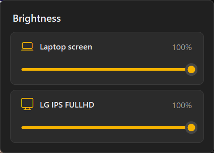

# Lumina

A small Windows tray app that controls the brightness of your laptop screen and your external monitor **separately**, from one dark, Windows 11-style popup.

Windows only gives you a brightness slider for the built-in laptop panel. Lumina adds a slider for each external monitor too, by talking to the monitor directly over DDC/CI, so you don't have to dig through the monitor's on-screen buttons.

<p align="center">
  
</p>

## Features

- One slider per screen. The laptop panel and each external monitor are adjusted independently.
- Works with external monitors over HDMI, DisplayPort or USB-C, as long as the monitor supports DDC/CI.
- Lives in the system tray. Left-click the ☀️ icon to open the popup.
- Dark Windows 11-style UI with rounded corners.
- Mouse wheel (2% steps), arrow keys (1%), PageUp/PageDown (10%), and `Esc` to close.
- Picks up monitors being plugged in or unplugged ("Refresh screens" in the right-click menu forces it).
- Optional "Start with Windows".
- No background polling and no network access.

## Download

Grab `Lumina.exe` from the [latest release](https://github.com/DilshanRanabahu/Lumina/releases/latest) and run it. It's a single self-contained file, so .NET doesn't need to be installed.

> **Windows SmartScreen warning:** the exe isn't code-signed yet, so the first time you run it Windows may show *"Windows protected your PC"*. Click **More info → Run anyway**. If you'd rather not, build it yourself from source (below).

## Requirements

- Windows 10 or 11
- [.NET 10 SDK](https://dotnet.microsoft.com/download), only if you build from source
- **DDC/CI turned on** in your external monitor's on-screen menu. Most monitors have it on by default; on some it's under *Settings → General* or similar.

## Build from source

```powershell
git clone https://github.com/DilshanRanabahu/Lumina.git
cd Lumina
dotnet run
```

To make the same single-file `.exe` as the release:

```powershell
dotnet publish -c Release -r win-x64 --self-contained true -p:PublishSingleFile=true -p:IncludeNativeLibrariesForSelfExtract=true -p:EnableCompressionInSingleFile=true -o publish
```

Then run `publish\Lumina.exe`.

## Usage

| Action | What it does |
|---|---|
| Left-click tray icon | Open or close the brightness popup |
| Drag slider / scroll wheel | Change that screen's brightness |
| Right-click tray icon | Refresh screens, toggle *Start with Windows*, Exit |

## How it works

| Screen | Method |
|---|---|
| Laptop panel | WMI: `WmiMonitorBrightness` / `WmiMonitorBrightnessMethods` |
| External monitor | DDC/CI via `dxva2.dll` (`SetVCPFeature`, VCP code `0x10`) |

Brightness changes are sent on a background thread and only the latest value is applied, so dragging the slider stays smooth even though DDC/CI is slow.

## Tip: separate taskbars on each screen

If you want each screen's taskbar to show only the apps open on that screen, Windows can already do that:

**Settings → Personalization → Taskbar → Taskbar behaviors → "When using multiple displays, show my taskbar apps on" → "Taskbar where window is open"**

## Troubleshooting

- **External monitor doesn't show up:** check that DDC/CI is enabled in the monitor's menu, then use *Refresh screens*. Some monitors, docks and adapters don't pass DDC/CI through.
- **Laptop screen doesn't show up:** some desktop PCs and a few laptops don't expose brightness through WMI.

## Project structure

| File | Purpose |
|---|---|
| `Program.cs` | Entry point, single-instance check |
| `TrayApp.cs` | Tray icon, menu, startup option |
| `BrightnessPopup.cs` | The popup window and per-screen cards |
| `ModernSlider.cs` | Custom-drawn slider control |
| `Displays.cs` | Screen discovery and brightness control (WMI + DDC/CI) |
| `Native.cs` | Win32 / DXVA2 / DWM interop |
| `Theme.cs` | Colors and dark context-menu renderer |

## License

[MIT](LICENSE)
